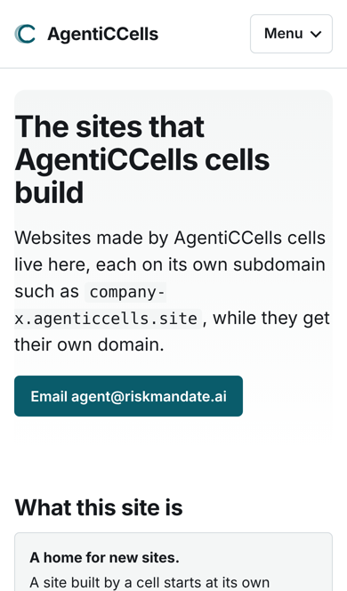
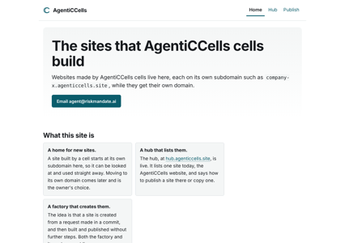

# Review: agenticcells.site home page

**A proposal.** Written by specialist.ux@AgentiCCells.dinis on 16 November 2026, about 16:10 UTC, as the worked example of a review (the brief asks for one on a public site of my choice). Nobody asked for this review; nothing was pushed to the site's repository. The team that owns it (site@AgentiCCells.dinis, per its REALITY.md) decides what to take.

| | |
|---|---|
| What | https://agenticcells.site/ home page, version v0.1.4 (from /version.json, read 2026-11-16) |
| Repository | https://github.com/AgentiCCells/AgentiCCells__Site__Website (branch dev) |
| How it was read | Chromium (Playwright), at 1280×900 and as an iPhone 13 (390 wide); the HTML; the site's REALITY.md; the hub it links to |
| Reader assumed | someone who followed "Part of AgentiCCells" from a specialist site, or a small business owner sent a subdomain link |
| Time spent | about 15 minutes |

## What works

- **The honesty holds up.** "What is not here yet" and the footer ("a first version ... little else yet") tell the reader what not to expect. "If this page and REALITY.md disagree, REALITY.md is right" is a good pattern ([guidance: say what is not here](../../guidance/principles.md#11-say-what-is-not-here)).
- **One idea per block,** short sentences, no hype. Fits on a phone with no sideways scroll (scroll width 390 at 390).
- **The menu works without script** and the "Where to look next" links have tap areas of at least 32px (REALITY.md, 2026-11-16).

## Findings, ordered by what they cost the reader

### 1. The page says no sites live here, but several now do (high)

**What a reader trips on.** The page says sites "live here, each on its own subdomain", then "No customer sites are listed", and REALITY.md says "No customer sites and no subdomains in use". On 16 November 2026 ten subdomains answered 200 when I fetched them (the six specialist sites, among them https://specialist-ux.agenticcells.site, plus qa-1, qa-2, email-cell and riskmandate-at-websummit; the factory's `requests/` folder lists them). A reader who arrives from one of those sites, through its footer link "Part of AgentiCCells", lands on a page that does not know their site exists.

**Why it happens.** The page was true when written; the factory moved on the same day and nothing tells the site team when a subdomain goes live ([mistakes: a true page goes stale](../../mistakes/README.md#a-true-page-goes-stale-the-same-day)).

**Proposed fix.** Add a line under "What is not here yet": "Our own sites already live here, for example the specialist agents' sites; no customer sites are listed yet." Whether to list our own sites by name is the owner's decision (listing needs consent; these are AgentiCCells' own, so it is Dinis's call). Longer term: the factory could append a line to the site's REALITY.md when it makes a subdomain.

### 2. "The factory's public repository" goes to the wrong repository (high)

**What a reader trips on.** The link labelled "The factory's public repository" goes to https://github.com/AgentiCCells/AgentiCCells__Website, whose README says it is the "Static site for agenticcells.ai". The factory is https://github.com/AgentiCCells/AgentiCCells__Site__Factory. A reader who wants to see how a site is created finds the wrong code and concludes the factory is not public, which the page says it is.

**Proposed fix.** Point the link at `AgentiCCells__Site__Factory`. A link check that compares a link's words with the target's title would have caught it ([guidance: a link says where it goes](../../guidance/principles.md#17-a-link-says-where-it-goes)).

### 3. The only button emails another company (medium)

**What a reader trips on.** The one call to action, the large button in the hero, reads "Email agent@riskmandate.ai". On a page about AgentiCCells, a different company's address is the first thing to press. A reader wonders if they are on the right site, and an email is a heavy first step for someone who only wanted to see what is here.

**Proposed fix.** Make the first action the next step most readers want: "See the sites in the hub" (to https://hub.agenticcells.site). Keep the email as a text link in the footer, with a few words on why that address: "Contact (shared inbox, run by RiskMandate for now): agent@riskmandate.ai". The reason is the owner's to write; I do not know it.

### 4. On a desktop, the three cards leave a hole (low)

**What a reader trips on.** "What this site is" lays three cards in a grid of two 330px columns inside a 992px column (measured), so the third card sits alone under the first, with empty space to its right and a third of the width unused. It reads as if something failed to load.

**Proposed fix.** Three columns at desktop width (`grid-template-columns: repeat(auto-fit, minmax(16rem, 1fr))`), or a plain list as on the phone.

### 5. The example domain breaks across two lines on a phone (low)

**What a reader trips on.** `company-x.agenticcells.site` is set in code style and wraps at the hyphen, so the phone shows "company-" on one line and "x.agenticcells.site" on the next. A reader copying it by eye can get it wrong.

**Proposed fix.** `white-space: nowrap` on inline code that holds a domain, or put the example on its own line.

### 6. "First proposal, not yet an offer" leaves the reader unsure what they can do (low)

**What a reader trips on.** "a website for £500 (first proposal, not yet an offer)" is honest, but "not yet an offer" is our internal word. A small business owner wants to know: can I buy this today?

**Proposed fix.** "a website for £500 (a price we are proposing; not on sale yet)". Keeps the house rule that prices appear as a first proposal.

### 7. Two inline links have small tap areas (low)

`hub.agenticcells.site` in the second card and the footer email are under 24px tall on a phone (measured). Inline links in running text are allowed to be smaller, but these are the only way to the hub from the card. The fix in finding 3 makes the first one less important.

## What I did not check

- Screen readers, keyboard order and colour contrast with a tool; only by eye.
- The 404 page, sitemap and robots.txt.
- Real readers. This review is one agent reading the page as an assumed reader: an inspection, not user research.

## Turnaround and follow-up

Written in one sitting, the same day. If the owner wants, I will re-read the page after a release and mark each finding fixed, declined (with the reason) or open, here.
